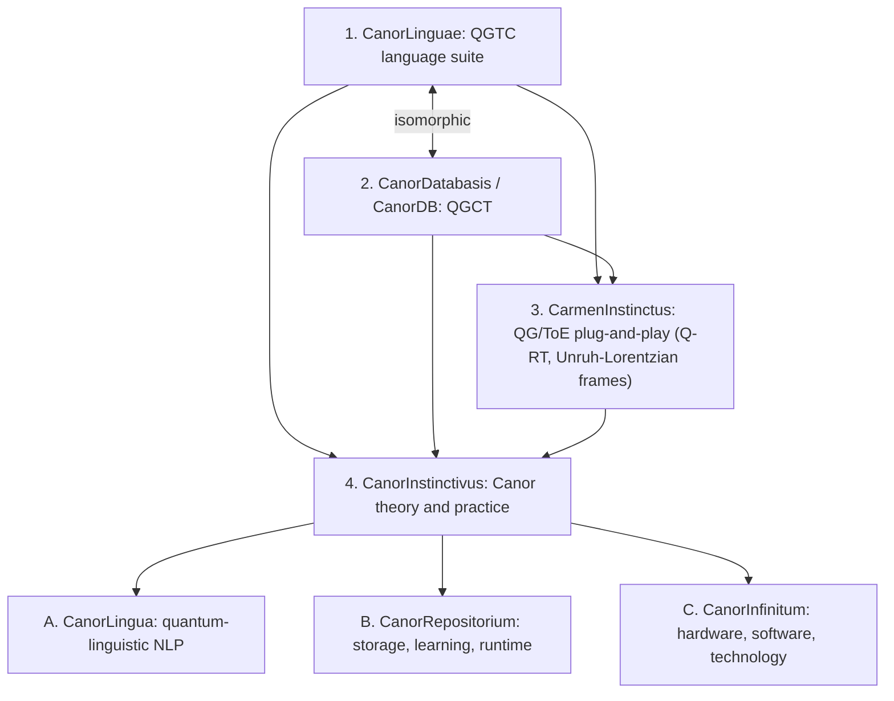
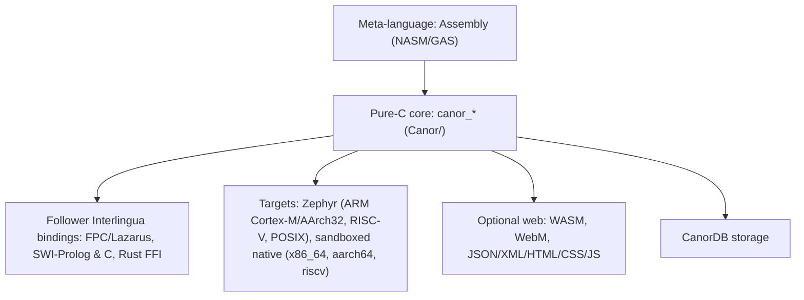

# DESIGN.md: System Architecture

## Architectural Goals

- **Deterministic Integer Execution:** Guarantees bit-identical computational results across all hardware architectures using exact integer arithmetic and closed interval bounds without floating-point drift.
- **Universal Target Deployment:** Executes natively on bare-metal microcontrollers via Zephyr RTOS, runs within containerized or sandboxed native host sessions, and optionally compiles to WebAssembly for browser deployment.
- **Formally Verified Foundations:** Grounded in the formal specifications of the Canor Working Draft and Z-Notation mathematical definitions.

## System Composition (QGTC / QGCT)

## CanorLinguae: The Ten Languages ([docs/Canor.md](docs/Canor.md))

| § | Language | Role |
|---|---|---|
| 1 | **Strategy™** | Differential imaginary bases `di … dg`. Cayley–Dickson projection of the sedenions onto associative quaternionic caches (the Hamilton trifectas) |
| 2 | **Flow™** | Ordered, immutable atom sequences over Hamilton's quaternionic trifectas (e.g. `i,j,k`) |
| 3 | **MetaFlow™** | ≤ 4 labeled atoms: `R` Reals, `G` Gaps, `B` Bases, `A` Auxiliaries |
| 4 | **Action™** | Integer dimensional constants and typed modular constraints: `L ≡ R (mod N)` with canonical residues |
| 5 | **Soul™** | Flow + MetaFlow + Action → executable symbol. Traversal emits an n+1 count stream |
| 6 | **Maneuver™** | Binds a Soul symbol to a symbolic expression (bra-ket notation). 1:1, 1:n, and n:1 junctions; benchmarked by timing fields |
| 7 | **United™** | Interchange language and `.fwo` container (JSON/XML artifacts, canonical digest) |
| 8 | **Elite™** | Procedural invocation and branching assembler. Side-effect-free |
| 9 | **Follower™ / Carmen™ Interlingua** | Main interoperability layer to complementary languages, pipe-dot (`\| ... .`) framed. Runtime effects only when authorized |
| 10 | **Aether™** | Integer binary-tree IR plus timing-library linker (op/sec, latency/jitter fields) |

**Core and profile split.** The core holds only the integer parts of each language, such as Hilbert ordering, quadtrees, mipmaps and checksums for Soul. Diffusion transformers, MCMC and agent- or LLM-guided rewriting are profile-defined. Their outputs enter as recorded inputs with seed and provenance. Reaching a configured limit is reported, never silently cut (MEMORY.md 2026-10-25).

## Implementation Layers

## Module Placement

For the exact assignment of core C11 headers, sources, and tests, see the [Canonical Module Mapping](MEMORY.md#canonical-module-mapping-approved).

## State and Effect Governance

- **Pure Assembly Evaluation:** Assembly and pattern exploration (Elite, Maneuver verification) are strictly pure; they parse and record declared state transitions without mutating memory or databases.
- **Contract-Authorized Runtime:** Runtime execution (Maneuver Groups, Elite dispatch, Follower language blocks) may read or write CanorDB only when authorized by active contracts in `.fwp` and `.fws` profiles.
- **Deterministic Real-Time Instrumentation:** Every signaling event is instrumented by a $3 \times 3 \times 3$ timing field (`canor_field3_t`) capturing `PRE/PERI/POST × MIN/NOM/MAX × LOW/VALUE/HIGH` latency and jitter metrics.
- **Transactional Rollback:** Rollback and commit semantics for failed CanorDB transitions are profile-defined and tracked as explicit open items.

## Sandboxing Architecture

Platform sandboxing enforces strict system call and memory boundary isolation:
- **Embedded Targets:** Enforced via Zephyr RTOS memory protection units (MPU) and user-mode isolation.
- **Host POSIX / Linux:** Bounded by `seccomp` and `Landlock` system call filters.
- **Windows:** Isolated via AppContainer boundaries and restricted token privileges.
- **macOS:** Bounded by `sandbox-exec` Profiles.

## Aether Propositum (Future Research Programs)

The foundational architecture supports four forward-looking mathematical research extensions:
- **W. Novus Certificationum:** Automated formal certification of zero-knowledge and post-quantum invariant proofs.
- **X. Tempus Vitae:** Real-time lifecycle bounds, temporal execution budgets, and formal survival guarantees.
- **Y. Canor Infinitum:** Unbounded hypercomplex and transfinite ordinal arithmetic.
- **Z. Aether Superintelligenticae:** Autonomous multi-agent coordination protocols and high-order semantic reasoning lattices.
