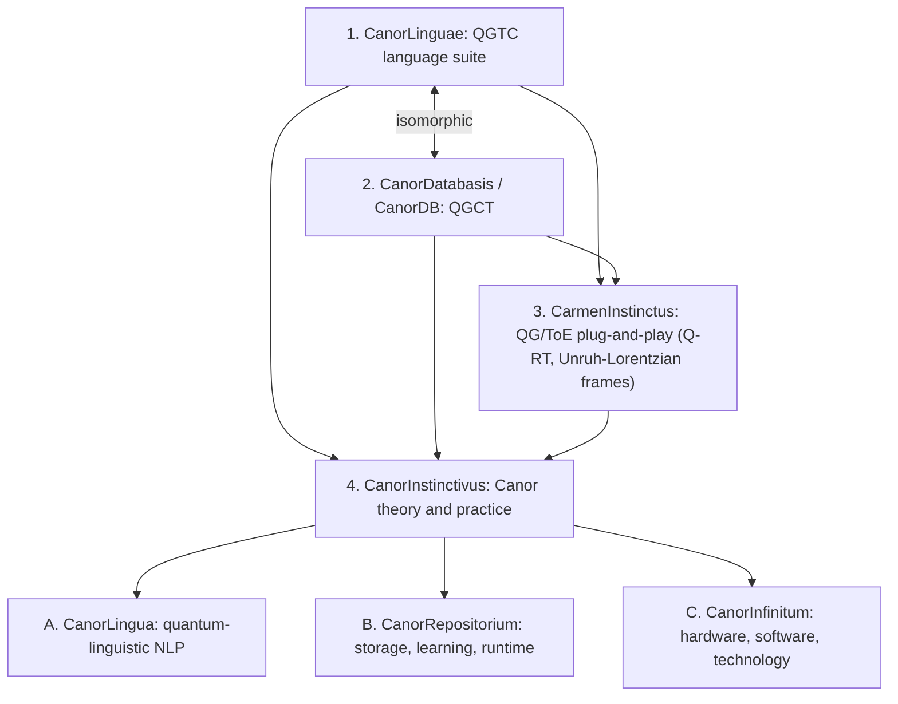
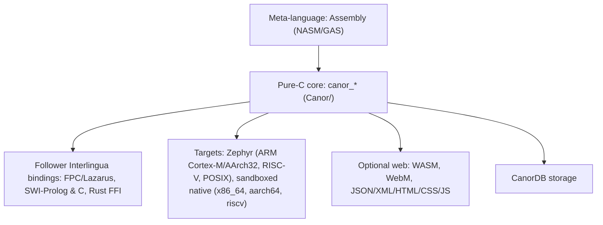

# DESIGN.md: System Architecture

## Architectural Goals

- **Deterministic Integer Execution:** Guarantees bit-identical computational results across all hardware architectures using exact integer arithmetic and closed interval bounds without floating-point drift.
- **Universal Target Deployment:** Executes natively on bare-metal microcontrollers via Zephyr RTOS, runs within containerized or sandboxed native host sessions, and optionally compiles to WebAssembly for browser deployment.
- **Formally Verified Foundations:** Grounded in the formal specifications of the Canor Working Draft and Z-Notation mathematical definitions.

## System Composition (QGTC / QGCT)

## CanorLinguae: The Nine Layered Interoperability Languages

| § | Language | Role and Formal Definition |
|---|---|---|
| 1 | **Flow™** | Defines immutable, ordered sequences of imaginary-base atoms grouped into registered Hamilton-style trifectas (e.g. `i,j,k`). |
| 2 | **MetaFlow** | Structures multi-channel organizational representations across up to four bounded slots: Reals (`R`), Gaps (`G`), Bases (`B`), and Auxiliaries (`A`). |
| 3 | **Action™** | Imposes typed modular constraints ($L \equiv R \pmod N$) evaluated using canonical non-negative residues. |
| 4 | **Soul™** | Composes a Flow with an Action into an executable state symbol whose traversal produces a deterministic $n+1$ count stream. |
| 5 | **Maneuver™** | Binds Soul symbols to functional equations and tensor expressions across $1:1$, $1:n$, and $n:1$ algebraic junctions. |
| 6 | **United™** | Serves as the primary interchange container (`.fwo`), bundling language artifacts and optional JSON/XML manifests under a canonical digest. |
| 7 | **Elite™** | Provides side-effect-free, branch-retaining pattern assembly using Assembly as its meta-language. |
| 8 | **Follower™ Interlingua** | Coordinates plug-and-play bindings to external complementary languages (Free Pascal, SWI-Prolog, C, Rust FFI). (Latin locale: *Carmen™ Interlingua*). |
| 9 | **Aether™** | Encodes program semantics as an integer binary-tree Intermediate Representation (IR) instrumented by real-time latency and jitter timing fields. |

## Implementation Layers

## Module Placement

For the exact assignment of core C11 headers, sources, and tests, see the [Canonical Module Mapping](MEMORY.md#canonical-module-mapping-approved).

## State and Effect Governance

- **Pure Assembly Evaluation:** Assembly and pattern exploration (Elite, Maneuver verification) are strictly pure; they parse and record declared state transitions without mutating memory or databases.
- **Contract-Authorized Runtime:** Runtime execution (Maneuver Groups, Elite dispatch, Follower language blocks) may read or write CanorDB only when authorized by active contracts in `.fwp` and `.fws` profiles.
- **Deterministic Real-Time Instrumentation:** Every signaling event is instrumented by a $3 \times 3 \times 3$ timing field (`canor_field3_t`) capturing `PRE/PERI/POST × MIN/NOM/MAX × LOW/VALUE/HIGH` latency and jitter metrics.
- **Transactional Rollback:** Rollback and commit semantics for failed CanorDB transitions are profile-defined and tracked as explicit open items.

## Sandboxing Architecture

Platform sandboxing enforces strict system call and memory boundary isolation:
- **Embedded Targets:** Enforced via Zephyr RTOS memory protection units (MPU) and user-mode isolation.
- **Host POSIX / Linux:** Bounded by `seccomp` and `Landlock` system call filters.
- **Windows:** Isolated via AppContainer boundaries and restricted token privileges.
- **macOS:** Bounded by `sandbox-exec` Profiles.

## Aether Propositum (Future Research Programs)

The foundational architecture supports four forward-looking mathematical research extensions:
- **W. Novus Certificationum:** Automated formal certification of zero-knowledge and post-quantum invariant proofs.
- **X. Tempus Vitae:** Real-time lifecycle bounds, temporal execution budgets, and formal survival guarantees.
- **Y. Canor Infinitum:** Unbounded hypercomplex and transfinite ordinal arithmetic.
- **Z. Aether Superintelligenticae:** Autonomous multi-agent coordination protocols and high-order semantic reasoning lattices.
