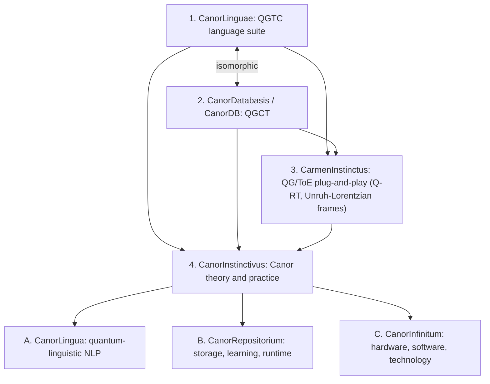
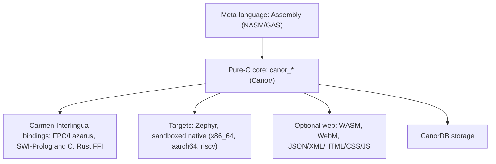

# DESIGN.md: Architecture

## Goals
- Deterministic, integer-only, bit-reproducible computation on every target.
- Runs bare-metal (Zephyr), in sandboxed native sessions, and optionally in-browser.
- Grounded in `Canor_Working-Draft_v1.pdf` and the CanorLinguae Z-Notation specification.

## QGTC/QGCT composition

## CanorLinguae: the nine languages
| § | Language | Role |
|---|---|---|
| 1 | **Flow™** | Ordered, immutable atom sequences. Registered trifectas (e.g. `i,j,k`) |
| 2 | **MetaFlow** | ≤ 4 labeled atoms: `R` Reals, `G` Gaps, `B` Bases, `A` Auxiliaries |
| 3 | **Action™** | Typed modular constraints: `L ≡ R (mod N)` with canonical residues |
| 4 | **Soul™** | Flow + Action → executable symbol. Traversal emits an n+1 count stream |
| 5 | **Maneuver™** | Binds a Soul symbol to a symbolic expression. 1:1, 1:n, and n:1 junctions |
| 6 | **United™** | Interchange language and `.fwo` container (JSON/XML artifacts, canonical digest) |
| 7 | **Elite™** | Procedural invocation and branching assembler. Side-effect-free |
| 8 | **Carmen™ Interlingua** | Main interoperability layer to complementary languages. Runtime effects only when authorized |
| 9 | **Aether™** | Integer binary-tree IR plus timing-library linker (op/sec, latency/jitter fields) |

## Implementation layers

## Module placement
See the [rename map](MEMORY.md#legacy--canor-rename-map).

## Effect model
- **Assembly** (Elite, Maneuver checking) is pure. It records declared effects without performing them.
- **Runtime** (Maneuver Groups, Elite execution, Carmen dispatch) may read or write CanorDB only under `.fwp` + `.fws` authorization.
- Every signaling event carries a 3×3×3 **latency/jitter field**: PRE/PERI/POST × MIN/NOM/MAX × LOW/VALUE/HIGH.
- TODO: rollback/commit semantics for failed CanorDB transitions (the draft marks this as unformalized).

## Sandboxing
TODO: per-OS mechanism (seccomp/Landlock, AppContainer, sandbox-exec, Zephyr userspace/MPU).

## Aether Propositum (future projects)
W. Novus Certificationum · X. Tempus Vitae · Y. Canor Infinitum · Z. Aether Superintelligenticae
